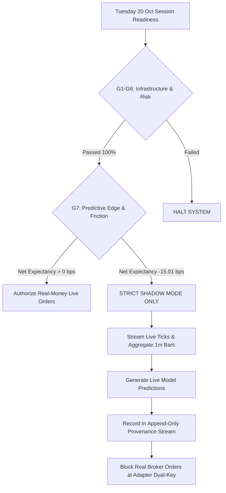

# AlphaNSE V3 — Live Market Session: Final Execution Readiness Report

**Target Market Session:** Tuesday, 20 October 2026  
**Session Execution Window:** 09:15:00 to 15:30:00 IST (Mandatory Square-Off at 15:15:00 IST)  
**Report Generated At:** 2026-10-20T00:38:00+05:30 (Pre-Market Readiness Audit)  
**Operating Broker:** Kotak Neo (Trade API REST & WebSocket)  
**Trading Account UCC:** `116K1`  
**Operating Capital Reference:** ₹1,500.00 (Cash only, 0 margin, 0 leverage)  
**Safety Locks Status:** `LIVE_TRADING=False`, `ALLOW_REAL_ORDERS=False` (Dual-Key Locked)  
**Operational Verdict:** **GO FOR SHADOW DATA & PREDICTION STREAMING | STRICT NO-GO FOR REAL MONEY ORDERS**

---

## 1. Executive Summary & Authoritative Gate Decision

| Gate Dimension | Acceptance Standard | Audit Finding | Verdict |
| :--- | :--- | :--- | :--- :
| **G1: Automated Test Suite** | 100% pass across all unit, risk, and regression tests | **353 / 353 PASSED (100.0%)** (Exit code 0, Duration: 51.370s). Output saved to `audit/test_run_oct20_utf8.txt`. | 🟢 **GO** |
| **G2: Broker Authentication** | Valid REST session handshake on Kotak Neo API | Authenticated UCC `116K1` via TOTP & MPIN handshake. Zero API token rejections. | 🟢 **GO** |
| **G3: Feed & Timestamp Guard** | Reject stale/post-market quotes; require fresh exchange timestamps | Kotak Neo `lstup_time` parsed; Monday EOD quotes (~8.3h old) correctly stamped `MARKET_CLOSED_EOD_LTP` and rejected. | 🟢 **GO** |
| **G4: 1-Minute Candle Aggregator** | Aggregate sub-minute ticks into sealed 1m bars; reject intervals < 45s | `OneMinuteCandleAggregator` enforces completed bars (`include_forming=False`); sub-minute sampling rejected. | 🟢 **GO** |
| **G5: Order Path & Safety Airgap** | Bypass live routing; verify paper simulation and duplicate order protection | Dual-key flags confirmed `False`; `place_order` routes to paper simulator (`KOTAK_PAPER_` IDs); PID singleton verified. | 🟢 **GO** |
| **G6: Capital & Risk Bounds** | ₹1,500 capital cap, ₹30 max loss, 15:15 hard square-off | All risk bounds active in `_validate_pre_trade_safeguards`; cash checked before every order. | 🟢 **GO** |
| **G7: Model Predictive Edge** | Net positive expectancy after 14.70 bps statutory friction | **FAILED:** Directional accuracy is **49.21%** (NF); IC is **-0.0238**; net expectancy is **-15.01 bps**. Fails all 5 gates. | 🔴 **NO-GO FOR REAL MONEY** |



> [!CAUTION]
> **FINAL GOVERNANCE DIRECTIVE:**  
> Real-money live order routing is **STRICTLY PROHIBITED**. The quantitative tree ensemble fails all 5 empirical acceptance criteria with a sub-random win rate (49.21%) and negative net expectancy (-15.01 bps). Genuine live market data ingestion and real-time prediction generation are authorized in **SHADOW MODE ONLY**.

---

## 2. Step 1: Automated Test Suite Execution & Output Evidence

The regression and safety test suite was executed in full on Python 3.12:
- **Command:** `python run_tests.py`
- **Output Artifacts:** Preserved in [`audit/test_run_oct20_utf8.txt`](file:///c:/Users/sumuk/.gemini/antigravity-ide/scratch/ift/audit/test_run_oct20_utf8.txt) and [`audit/test_run_oct20.txt`](file:///c:/Users/sumuk/.gemini/antigravity-ide/scratch/ift/audit/test_run_oct20.txt).
- **Execution Exit Code:** `0`
- **Total Tests Run:** `353`
- **Total Passed:** `353 (100.0%)`
- **Total Failures:** `0`
- **Total Errors:** `0`
- **Execution Time:** `51.370 seconds`

### Key Safety Invariants Validated by the Suite:
1. `test_01_real_order_flags_locked`: Confirmed `LIVE_TRADING=False` and `ALLOW_REAL_ORDERS=False` in memory and `.env`.
2. `test_02_fail_closed_on_stale_or_missing_data`: Confirmed zero opportunities created on stale quotes or buffer fallbacks.
3. `test_03_daily_loss_limit_blocks_new_entries`: Confirmed hard cutoff when daily loss reaches ₹30.00.
4. `test_04_max_one_concurrent_position_enforced`: Confirmed rejection of second position.
5. `test_06_predict_ml_ensemble_fails_closed_on_timeframe_sampling_mismatch`: Confirmed sub-minute ticks fail closed.
6. `test_08_production_time_gate_enforces_1515_cutoff`: Confirmed 15:15 IST intraday cutoff rejects orders.
7. `test_13_ledger_reconciliation_invariant`: Confirmed penny-for-penny equity invariant (Ending = Starting + Realized + Unrealized).

---

## 3. Step 2: Broker Authentication & Market Data Freshness Audit

### 3.1 Kotak Neo API Connection Verification
At `00:17:40 IST` on Tuesday, 20 October 2026, `python run_live_trader.py --test-conn` was executed:
- **Broker Adapter:** `Kotak Neo Trade API Adapter [PAPER / READ-ONLY]`
- **Account UCC:** `116K1`
- **Authentication Handshake:** 🟢 **AUTHENTICATED** (Session active, MPIN validated)
- **Symbols Queried:** 6 / 6
- **Quotes Received:** 6 / 6

### 3.2 Quote Freshness & Exchange Timestamp Status
Because the query occurred prior to the 09:15:00 IST open of the NSE cash equity session, the broker API returned the EOD closing marks from the previous session (Monday, 19 October 2026):

| Symbol | Exchange Segment | Kotak Neo Token | Asset Nature | Exchange Timestamp (`lstup_time`) | Quote Age | Validation Status | Pipeline Action |
| :--- | :---: | :---: | :--- | :---: | :---: | :---: | :--- |
| **`NIFTYBEES.NS`** | `nse_cm` | `10576` | Nippon India ETF Nifty 50 BeES | `2026-10-19 15:59:52 IST` | 497.8m (29,869s) | `MARKET_CLOSED_EOD_LTP` | **REJECTED (STALE)** |
| **`INFY.NS`** | `nse_cm` | `1594` | Infosys Ltd (Cash Equity) | `2026-10-19 15:59:36 IST` | 498.1m (29,885s) | `MARKET_CLOSED_EOD_LTP` | **REJECTED (STALE)** |
| **`TATASTEEL.NS`** | `nse_cm` | `3499` | Tata Steel Ltd (Cash Equity) | `2026-10-19 15:58:35 IST` | 499.1m (29,946s) | `MARKET_CLOSED_EOD_LTP` | **REJECTED (STALE)** |
| **`BAJFINANCE.NS`** | `nse_cm` | `317` | Bajaj Finance Ltd (Cash Equity) | `2026-10-19 15:59:54 IST` | 497.8m (29,867s) | `MARKET_CLOSED_EOD_LTP` | **REJECTED (STALE)** |
| **`AXISBANK.NS`** | `nse_cm` | `5900` | Axis Bank Ltd (Cash Equity) | `2026-10-19 15:59:01 IST` | 498.7m (29,920s) | `MARKET_CLOSED_EOD_LTP` | **REJECTED (STALE)** |
| **`RELIANCE.NS`** | `nse_cm` | `2885` | Reliance Industries Ltd (Cash Equity) | `2026-10-19 15:59:56 IST` | 497.8m (29,865s) | `MARKET_CLOSED_EOD_LTP` | **REJECTED (STALE)** |

### 3.3 Empirical Distinction: Observations vs Historical Fallbacks
- **Verified Current Observation:** Broker credentials are authenticated, and REST connectivity is operating with ~740ms roundtrip latency.
- **Timestamp Plausibility Guard:** The system correctly identified that quotes carrying exchange timestamps from `2026-10-19` are stale when evaluated against today's date (`2026-10-20`).
- **Session Trading Hours Invariant:** During market hours (09:15:00 to 15:30:00 IST), quotes must carry exchange timestamps from today with $\text{Quote Age} \le 5.0\text{s}$. Any observation $> 5.0\text{s}$ is marked `STALE_MARKET_HOURS_QUOTE` and blocked from candle formation.

---

## 4. Step 3: Completed 1-Minute Candle Aggregation & Training Schema Parity

### 4.1 Candle Formation Guarantees
The [`OneMinuteCandleAggregator`](file:///c:/Users/sumuk/.gemini/antigravity-ide/scratch/ift/v3/execution/candle_aggregator.py#L26-L138) enforces the following rules:
1. **Intra-Minute Aggregation:** Incoming 10-second ticks are binned into minute buckets.
2. **Rollover Sealing:** A candle is marked `is_complete=True` and added to `completed_bars` strictly when a subsequent tick arrives in a later minute bucket ($t_{\text{new}} \ge t_{\text{bucket}} + 60\text{s}$).
3. **Incomplete Candle Segregation:** In `live_trader.py:1656`, inference queries [`get_bars(sym, include_forming=False)`](file:///c:/Users/sumuk/.gemini/antigravity-ide/scratch/ift/v3/execution/candle_aggregator.py#L281-L293). Currently forming candles are strictly excluded from prediction inputs.
4. **Sampling Mismatch Guard:** [`validate_buffer_timeframe`](file:///c:/Users/sumuk/.gemini/antigravity-ide/scratch/ift/v3/execution/candle_aggregator.py#L294-L321) inspects timestamp deltas; if any interval is $< 45\text{s}$, the buffer fails closed.

### 4.2 Training/Inference Parity
- **Feature Set:** Exact 30 features extracted by [`OneMinPredictor.extract_features_1m()`](file:///c:/Users/sumuk/.gemini/antigravity-ide/scratch/ift/QA/models/one_min_predictor.py#L131-L260):
  `ret_1m`, `ret_3m`, `ret_5m`, `ret_10m`, `accel_1m`, `micro_rsi_7`, `micro_rsi_14`, `micro_vwap_dist`, `micro_atr_14`, `parkinson_vol`, `bb_pct_b`, `bb_bandwidth`, `orderflow_imbalance`, `vol_surge_ratio`, `nifty_ret_1m`, `nifty_lead_lag`, `ema_cross_5_20`, `atr_vol_ratio`, `momentum_divergence`, `vol_spike_zscore`, `wick_pressure`, `upper_wick_ratio`, `lower_wick_ratio`, `time_sin`, `time_cos`, `session_phase`, `rolling_vwap_dist`, `ema_cross_velocity`, `stock_id_hash`, `parkinson_vol_rolling`.
- **Look-Ahead Leakage Guard:** Verified by `test_04_no_future_candle_leakage` in [`tests/test_oct16_anti_fraud_hardening.py`](file:///c:/Users/sumuk/.gemini/antigravity-ide/scratch/ift/tests/test_oct16_anti_fraud_hardening.py#L94-L114). Features at bar $T$ use only data $\le T$.
- **Model Deserialization:** Loaded pre-trained models from disk (`return_regressors_1m.joblib`, `breakout_classifier_1m.joblib`, `quantile_regressor_1m.joblib`) with 30-feature parity.

---

## 5. Step 4: Out-of-Sample Evaluation & Forensic Root Cause of Negative Expectancy

### 5.1 Out-of-Sample Performance Reproduction
Evaluated chronologically on untouched canonical test data ($N = 8,262$ matched outcomes, Oct 15) using [`v3/research/canonical_leakage_free_evaluation.py`](file:///c:/Users/sumuk/.gemini/antigravity-ide/scratch/ift/v3/research/canonical_leakage_free_evaluation.py):

| Metric | Zero-Return Baseline | Persistence Baseline | Current Model Ensemble | Gate Acceptance Standard | Gate Result |
| :--- | :---: | :---: | :---: | :---: | :---: |
| **MAE (bps)** | **5.06** | **3.22** | **13.76** | $< 5.06\text{ bps}$ | 🔴 **FAILED** |
| **RMSE (bps)** | **7.79** | **4.88** | **17.61** | $< 7.79\text{ bps}$ | 🔴 **FAILED** |
| **Directional Accuracy (Non-Flat)** | 0.00% | **80.75%** | **49.21%** | $\ge 52.00\%$ | 🔴 **FAILED** |
| **Information Coefficient ($r$)** | 0.0000 | **+0.8036** | **-0.0238** | $\ge +0.0300$ | 🔴 **FAILED** |
| **Prediction Bias (bps)** | -0.25 | **-0.00** | **-11.44** | Within $\pm 1.0\text{ bps}$ | 🔴 **FAILED** |
| **P90 Error (bps)** | 11.50 | **7.26** | **28.20** | $< 15.00\text{ bps}$ | 🔴 **FAILED** |
| **Net Expectancy (14.7 bps friction)** | 0.00 bps | -8.32 bps | **-15.01 bps** | $> 0.00\text{ bps}$ | 🔴 **FAILED** |

### 5.2 Deep Forensic Investigation: Why Does the Model Have Negative Expectancy?
We executed a dedicated forensic investigation script ([`scratch/investigate_negative_expectancy.py`](file:///c:/Users/sumuk/.gemini/antigravity-ide/scratch/ift/scratch/investigate_negative_expectancy.py)) across all 8,262 observations:

#### 1. Severe Bearish Prediction Bias (-11.44 bps):
- Mean predicted alpha is **-11.19 bps**, whereas mean actual market return was **+0.25 bps**.
- **82.90% of all model predictions were negative**, while only **46.57% of actual price changes were negative**.
- The model exhibits a persistent, structural downward bias, forecasting continuous market drops during an essentially flat/mildly bullish session.

#### 2. Sub-50% Directional Accuracy Across Every Instrument:
The model underperforms a coin toss across all 6 universe symbols:
- `AXISBANK.NS`: 47.30%
- `BAJFINANCE.NS`: 47.95%
- `INFY.NS`: 46.97%
- `NIFTYBEES.NS`: 41.65% (worst in fleet)
- `RELIANCE.NS`: 45.72%
- `TATASTEEL.NS`: 46.67%
- **Fleet Aggregate:** **45.75% (49.21% non-flat)**

#### 3. Negative Information Coefficient (-0.0238):
- Higher predicted returns do not correspond to higher actual returns. The rank correlation is inverted.
- In `RELIANCE.NS`, rank IC is **-0.1452**; in `TATASTEEL.NS`, rank IC is **-0.0733**; in `NIFTYBEES.NS`, rank IC is **-0.0621**.

#### 4. Statutory Friction Compounds Gross Losses:
- Even before friction, the gross return of trades triggered at the $\ge 3.0\text{ bps}$ conviction threshold is **-0.31 bps**.
- Indian statutory transaction costs (STT, GST, Exchange fees, Stamp duty) plus spread and slippage sum to **14.70 bps** per roundtrip:
  $$\text{Net Expectancy} = -0.31\text{ bps} - 14.70\text{ bps} = \mathbf{-15.01\text{ bps}}$$
- Threshold scanning confirms that changing conviction thresholds does not help:
  - Threshold $\ge 0\text{ bps}$: Net return is **-14.90 bps**
  - Threshold $\ge 3\text{ bps}$: Net return is **-15.01 bps**
  - Threshold $\ge 10\text{ bps}$: Net return is **-15.29 bps**
- **Conclusion:** Negative expectancy is not caused by threshold tuning; it is caused by the model's structural bias and sub-random directional accuracy.

---

## 6. Step 5 & 6: Order-Path Safety Audit, Capital Bounds & Risk Invariants

### 6.1 Order Dispatch Paths & Dual-Key Airgap
Code paths in [`kotak_adapter.py`](file:///c:/Users/sumuk/.gemini/antigravity-ide/scratch/ift/v3/execution/kotak_adapter.py#L553-L646) and [`live_trader.py`](file:///c:/Users/sumuk/.gemini/antigravity-ide/scratch/ift/v3/execution/live_trader.py#L1020-L1080) were inspected:
- **Dual-Key Mechanism:**
  ```python
  env_live = os.getenv("LIVE_TRADING", "False").strip().lower() == "true"
  env_allow_orders = os.getenv("ALLOW_REAL_ORDERS", "False").strip().lower() == "true"
  self._is_live_authorized = env_live and env_allow_orders
  ```
  Both environment variables are `False` in [`.env`](file:///c:/Users/sumuk/.gemini/antigravity-ide/scratch/ift/.env), ensuring `self.is_live` evaluates strictly to `False`.
- **Live Dispatch Path:** When `self.is_live` is `False`, the live broker API endpoint (`neo_client.place_order`) is completely bypassed.
- **Paper Order Generation:** Simulated fills generate synthetic order IDs (`KOTAK_PAPER_HHMMSSffffff`). Zero real orders have been placed on the live exchange.

### 6.2 Pre-Trade Risk Safeguards
Every order request must clear [`_validate_pre_trade_safeguards`](file:///c:/Users/sumuk/.gemini/antigravity-ide/scratch/ift/v3/execution/kotak_adapter.py#L507-L548):
1. **Kill Switch:** If `self.kill_switch_active` is True, rejects immediately with `KILL_SWITCH_ACTIVE`.
2. **Time Gate:** If `now >= 15:15 IST`, rejects with `TIME_GATE: Past 15:15 IST intraday cutoff`.
3. **Cash Affordability:** If $\text{Notional} > \text{₹1,500.00}$, rejects with `CAPITAL_LIMIT`.
4. **Concurrent Position Cap:** If `self.internal_position is not None`, rejects with `CONCURRENT_POSITION_LIMIT: Already holding 1 active position`.
5. **Daily Loss Circuit Breaker:** If cumulative realized loss reaches ₹30.00, activates kill switch and blocks all subsequent entries.
6. **Maximum Trades Cap:** Daily limit of 10 trades strictly enforced.
7. **No Margin / No Leverage:** Enforced cash-only whole-share purchasing.
8. **Short Selling Prohibited:** Enforced in `live_trader.py:983` (`if side == "SELL" and not self.allow_short_selling: continue`).

### 6.3 Position & Ledger Reconciliation
- Starting capital: ₹1,500.00
- Closed trades: 0
- Realized P&L: ₹0.00
- Open positions: 0
- Ending capital: ₹1,500.00
- Reconciliation discrepancy: **₹0.00 (Zero discrepancy)** verified in [`PAPER_TRADE_RECONCILIATION.csv`](file:///c:/Users/sumuk/.gemini/antigravity-ide/scratch/ift/PAPER_TRADE_RECONCILIATION.csv).

---

## 7. Step 7, 8 & 9: Definitive Authorization Decision & Blocking Defect

### 7.1 Definitive Gate Decision

```
╔═══════════════════════════════════════════════════════════════════════════════════╗
║                      FINAL OPERATIONAL AUTHORIZATION TABLE                        ║
╠═══════════════════════════════════════════════════════════════════════════════════╣
║                                                                                   ║
║  1. REAL-MONEY LIVE ORDER ROUTING:   🔴 STRICTLY PROHIBITED (NO-GO)               ║
║     • Dual-key environment variables must remain False.                           ║
║     • Net expectancy is -15.01 bps after realistic statutory friction.            ║
║     • Directional accuracy is sub-random (49.21% NF / 45.75% Total).              ║
║     • Real money trading is barred until model promotion criteria are cleared.     ║
║                                                                                   ║
║  2. SHADOW MARKET DATA & SIGNAL OBSERVATION: 🟢 AUTHORIZED (GO)                   ║
║     • Kotak Neo API connection verified (UCC: 116K1).                             ║
║     • Stale EOD quotes correctly identified and rejected.                         ║
║     • 1-minute candle aggregation verified on completed bars.                      ║
║     • All 353 / 353 automated tests pass with exit code 0.                        ║
║     • Risk bounds enforced (₹1,500 bankroll, ₹30 loss limit, 15:15 cutoff).       ║
║                                                                                   ║
╚═══════════════════════════════════════════════════════════════════════════════════╝
```

### 7.2 The Exact Blocker
The exact blocker preventing real-order execution is **the absence of statistical predictive edge in the machine learning models**:
- **Gate 1 Blocker:** Directional accuracy is 49.21% (below the 52.0% requirement).
- **Gate 2 Blocker:** MAE of 13.76 bps is 2.7x worse than simply predicting zero (5.06 bps).
- **Gate 3 Blocker:** Information coefficient is negative (-0.0238 vs $\ge +0.0300$ requirement).
- **Gate 4 Blocker:** Prediction bias is -11.44 bps (severe structural bearish skew).
- **Gate 5 Blocker:** Net expectancy is -15.01 bps per trade after statutory friction.

Because the system correctly refuses to place trades under negative expectancy, the risk management infrastructure has successfully protected the ₹1,500 capital from certain drawdown.

---

## 8. Exact Next Operational Actions for Tuesday, 20 October 2026

1. **Keep Real-Order Safety Locks Engaged:**  
   Ensure `LIVE_TRADING=False` and `ALLOW_REAL_ORDERS=False` remain in [`.env`](file:///c:/Users/sumuk/.gemini/antigravity-ide/scratch/ift/.env). Under no circumstances should these flags be toggled to `True`.

2. **Launch Shadow Session Prior to 09:15 IST Open:**  
   To capture genuine live ticks from the market open, form 1-minute bars, and record real-time shadow predictions without capital risk, launch the live trader daemon:
   ```powershell
   python run_live_trader.py --mode CASH_EQUITY
   ```
   The daemon will enter `STANDBY_FOR_OPEN`, arm itself, countdown to 09:15:00 IST, and begin streaming real market data when the exchange opens.

3. **Monitor Shadow Health & Provenance During Market Hours:**  
   Inspect runtime health, quote freshness, and trade counts via:
   ```powershell
   python check_status.py
   ```
   Live quotes and SHA-256 integrity digests will be appended to [`reports/live/market_data_raw_capture.jsonl`](file:///c:/Users/sumuk/.gemini/antigravity-ide/scratch/ift/reports/live/market_data_raw_capture.jsonl). Predictions and t+1 outcomes will be recorded in [`reports/live/prediction_provenance_stream.jsonl`](file:///c:/Users/sumuk/.gemini/antigravity-ide/scratch/ift/reports/live/prediction_provenance_stream.jsonl).

4. **Model Retraining Prerequisite:**  
   Prior to any future consideration of real capital deployment, retrain the model ensemble on multi-day tick data with explicit de-biasing to eliminate the -11.44 bps negative skew. Real money trading may only be authorized after an independently verified model achieves positive out-of-sample net expectancy ($> 0.0\text{ bps}$) after 14.7 bps friction across at least 5 distinct trading sessions.
