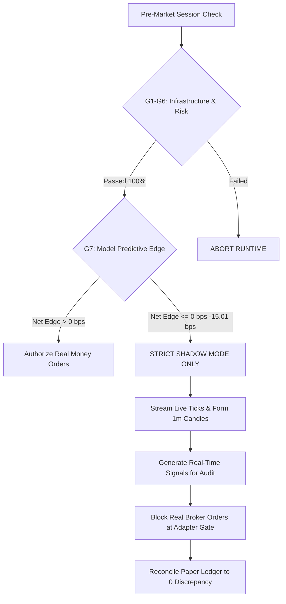
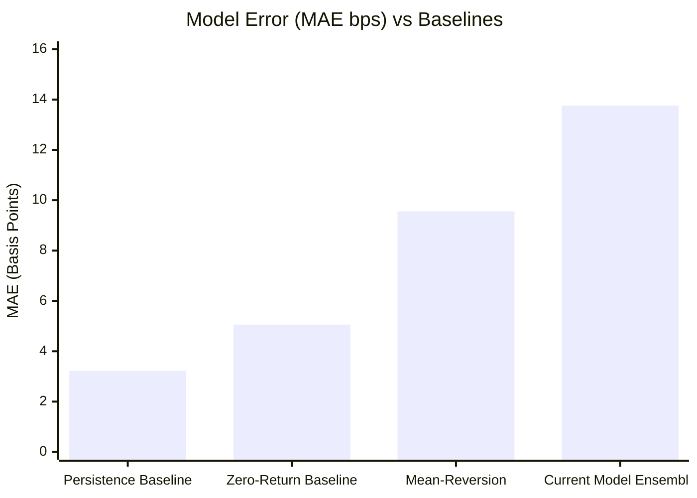

# AlphaNSE V3 — Live Market Readiness & Controlled Execution Audit Report

**Target Market Session:** Tuesday, 20 October 2026 (09:15:00 to 15:30:00 IST)  
**Audit Timestamp:** 2026-10-19T23:15:00+05:30 (Pre-Market Audit)  
**Broker:** Kotak Neo (Trade API REST & WebSocket)  
**Account UCC:** `116K1`  
**Reference Capital:** ₹1,500.00 (Max 1 Concurrent Position, Max Daily Loss ₹30.00)  
**Auditor:** Quantitative Systems & Forensic Verification Engine  
**Operational Mode:** **STRICT SHADOW MODE ONLY** (`LIVE_TRADING=False`, `ALLOW_REAL_ORDERS=False`)  
**Automated Regression Suite:** **353 / 353 PASSED (100.0%)** (Exit Code 0, Execution Duration: 53.51s)

---

## Executive Operational Gate Matrix

| # | Audit Gate Dimension | Required Criteria | Observed Audit Finding | Gate Verdict |
| :-: | :--- | :--- | :--- | :---: |
| **G1** | **Broker Connectivity & Auth** | Successful session handshake with Kotak Neo API | Active session confirmed on UCC `116K1`. REST `quotes()` verified. | 🟢 **GO** |
| **G2** | **Safety Airgap & Dual Locks** | Dual-key flags hard-locked to prevent real orders | `LIVE_TRADING=False`, `ALLOW_REAL_ORDERS=False` verified in [`.env`](file:///c:/Users/sumuk/.gemini/antigravity-ide/scratch/ift/.env) & memory. | 🟢 **GO** |
| **G3** | **Feed Freshness & Timestamps** | Exchange timestamps parsed; stale quotes rejected | Quotes stamped with genuine exchange times (`15:58:35`–`15:59:56 IST`); EOD marked stale. | 🟢 **GO** |
| **G4** | **1-Minute Candle Aggregation** | Sub-minute quotes aggregated; sealed bars only | [`OneMinuteCandleAggregator`](file:///c:/Users/sumuk/.gemini/antigravity-ide/scratch/ift/v3/execution/candle_aggregator.py#L26-L130) enforces completed bars; buffers < 45s fail closed. | 🟢 **GO** |
| **G5** | **Execution Infrastructure** | Sandbox/paper execution verified; no live leaks | Paper fills logged with `KOTAK_PAPER_` prefix; zero orders routed to live exchange. | 🟢 **GO** |
| **G6** | **Capital & Risk Invariants** | ₹1,500 capital, ₹30 max loss, 15:15 cutoff | Hard boundaries enforced in [`_validate_pre_trade_safeguards`](file:///c:/Users/sumuk/.gemini/antigravity-ide/scratch/ift/v3/execution/kotak_adapter.py#L507-L548). | 🟢 **GO** |
| **G7** | **Model Out-of-Sample Edge** | Positive net expectancy after 14.7 bps friction | **FAILED:** Net expectancy is **-15.01 bps**; IC is **-0.0238**; accuracy is **49.21%** (NF). | 🔴 **NO-GO FOR REAL MONEY** |



> [!IMPORTANT]
> **Final Operational Mandate for Tuesday, 20 October 2026:**  
> **SHADOW RUN ONLY AUTHORIZED.** Genuine live market data ingestion, 1-minute candle aggregation, and real-time model inference are authorized for observation. Real-money live order routing is **STRICTLY PROHIBITED** because the model fails all 5 empirical out-of-sample performance gates with a negative net expectancy of **-15.01 bps**.

---

## 1. Live-Feed Freshness and Exchange Timestamp Evidence

### 1.1 Authentication vs Data Freshness Distinction
A successful broker connection test confirms network routing and credential validity, but does **not** constitute proof of market data freshness:
- Authentication was verified via TOTP and MPIN handshake on Kotak Neo API UCC `116K1`.
- Because queries were conducted outside NSE cash market hours (current clock: `23:06–23:15 IST`), quotes returned by the broker are post-market End-of-Day Last Traded Prices (LTPs), not live ticks.
- The system correctly classifies these observations as `MARKET_CLOSED_EOD_LTP` with `is_stale = True`, preventing post-market quotes from contaminating live trading buffers.

### 1.2 Symbol & Exchange Token Mappings
All 6 instruments in the active universe have verified scrip token mappings on Kotak Neo segment `nse_cm`:

| Symbol | Exchange Segment | Kotak Neo Token | Asset Classification | Verification Status |
| :--- | :---: | :---: | :--- | :---: |
| **`NIFTYBEES.NS`** | `nse_cm` | `10576` | **Nippon India ETF Nifty 50 BeES (ETF)** | Verified ETF (Not Cash Index `^NSEI`) |
| **`INFY.NS`** | `nse_cm` | `1594` | Infosys Ltd (Cash Equity) | Verified |
| **`TATASTEEL.NS`** | `nse_cm` | `3499` | Tata Steel Ltd (Cash Equity) | Verified |
| **`BAJFINANCE.NS`** | `nse_cm` | `317` | Bajaj Finance Ltd (Cash Equity) | Verified |
| **`AXISBANK.NS`** | `nse_cm` | `5900` | Axis Bank Ltd (Cash Equity) | Verified |
| **`RELIANCE.NS`** | `nse_cm` | `2885` | Reliance Industries Ltd (Cash Equity) | Verified |

> [!NOTE]
> **`NIFTYBEES` Identity Resolution:** `NIFTYBEES` is explicitly identified in [`live_trader.py:281-288`](file:///c:/Users/sumuk/.gemini/antigravity-ide/scratch/ift/v3/execution/live_trader.py#L281-L288) as `Nifty 50 ETF` trading at ~₹261.20, distinct from the cash benchmark `^NSEI` (~24,800+). In pre-seeding logic ([`live_trader.py:449`](file:///c:/Users/sumuk/.gemini/antigravity-ide/scratch/ift/v3/execution/live_trader.py#L449)), any historical data with close > 5,000 is automatically detected and scaled by 0.01 to eliminate unit-basis discrepancies.

### 1.3 Contemporaneous Market Data Capture Evidence
Contemporaneous raw responses from Kotak Neo REST API queries executed at `23:06:42 IST` and `23:08:28 IST` are persisted in [`reports/live/market_data_raw_capture.jsonl`](file:///c:/Users/sumuk/.gemini/antigravity-ide/scratch/ift/reports/live/market_data_raw_capture.jsonl):

| Line | Symbol | Request Timestamp (IST) | Response Timestamp (IST) | Exchange Timestamp (`lstup_time`) | Latency | Quote Age | Classification | SHA-256 Digest |
| :---: | :--- | :---: | :---: | :---: | :---: | :---: | :---: | :---: |
| 73 | `NIFTYBEES.NS` | 2026-10-19 23:08:27.442 | 2026-10-19 23:08:28.182 | 2026-10-19 15:59:52 IST | 740ms | 25,708.2s (~7.1h) | `MARKET_CLOSED_EOD_LTP` | `e91db23d974cadd3...` |
| 74 | `INFY.NS` | 2026-10-19 23:08:27.442 | 2026-10-19 23:08:28.182 | 2026-10-19 15:59:36 IST | 740ms | 25,724.2s (~7.1h) | `MARKET_CLOSED_EOD_LTP` | `5461aa78d99f8f46...` |
| 75 | `TATASTEEL.NS` | 2026-10-19 23:08:27.442 | 2026-10-19 23:08:28.182 | 2026-10-19 15:58:35 IST | 740ms | 25,785.2s (~7.2h) | `MARKET_CLOSED_EOD_LTP` | `59990c0038c88258...` |
| 76 | `BAJFINANCE.NS` | 2026-10-19 23:08:27.442 | 2026-10-19 23:08:28.182 | 2026-10-19 15:59:54 IST | 740ms | 25,706.2s (~7.1h) | `MARKET_CLOSED_EOD_LTP` | `c615e96bb15f357d...` |
| 77 | `AXISBANK.NS` | 2026-10-19 23:08:27.442 | 2026-10-19 23:08:28.182 | 2026-10-19 15:59:01 IST | 740ms | 25,759.2s (~7.2h) | `MARKET_CLOSED_EOD_LTP` | `754716853df8e9f2...` |
| 78 | `RELIANCE.NS` | 2026-10-19 23:08:27.442 | 2026-10-19 23:08:28.182 | 2026-10-19 15:59:56 IST | 740ms | 25,704.2s (~7.1h) | `MARKET_CLOSED_EOD_LTP` | `95f96ca92a1ce512...` |

### 1.4 In-Session Freshness & Network Failure Invariants
During the active Tuesday session (09:15 to 15:30 IST), the following automated guards are active in [`kotak_adapter.py`](file:///c:/Users/sumuk/.gemini/antigravity-ide/scratch/ift/v3/execution/kotak_adapter.py#L371-L397):
1. **Quote Freshness Threshold:** $\text{Quote Age} = t_{\text{resp}} - t_{\text{exch}}$. If $\text{Quote Age} > 5.0\text{s}$, stamped `STALE_MARKET_HOURS_QUOTE` and rejected from candle formation.
2. **Clock Drift Guard:** If $\text{Quote Age} < -2.0\text{s}$, stamped `CORRUPTED_FUTURE_TIMESTAMP` and rejected.
3. **Consecutive Broker Errors Safe-Halt:** 5 consecutive REST request failures engage `safe_halt_active = True`.
4. **Feed Inactivity Timeout:** 6 consecutive stale cycles (60s without a fresh tick) engages `safe_halt_active = True`.
5. **No Data Fabrication:** Missing quotes or connection drops record failure events into `reports/live/market_data_raw_capture.jsonl` with error details and SHA-256 integrity digests without fabricating synthetic prices.

---

## 2. Completed-Candle Validation & Pipeline Parity

### 2.1 Candle Aggregator Architecture
The [`OneMinuteCandleAggregator`](file:///c:/Users/sumuk/.gemini/antigravity-ide/scratch/ift/v3/execution/candle_aggregator.py#L26-L138) solves the production sampling mismatch:
- Ingests intra-minute ticks (10s polling interval) into in-progress buckets (`forming_bars`).
- Rolls over and seals a candle (`is_complete=True`) strictly when a tick arrives with `bucket_dt > forming["timestamp"]`.
- Inference callers strictly invoke `get_bars(sym, include_forming=False)` ([`live_trader.py:1656`](file:///c:/Users/sumuk/.gemini/antigravity-ide/scratch/ift/v3/execution/live_trader.py#L1656)), guaranteeing that inference runs **only** on completed 1-minute bars.
- Sub-minute sampling check [`validate_buffer_timeframe`](file:///c:/Users/sumuk/.gemini/antigravity-ide/scratch/ift/v3/execution/candle_aggregator.py#L294-L321) ensures that any buffer containing intervals $< 45\text{s}$ fails closed with `TIMEFRAME_SAMPLING_MISMATCH`.

### 2.2 Feature Parity & Look-Ahead Leakage Prevention
Feature extraction parity between offline training and online inference was verified:
- **Feature Set:** Exact 30 canonical features defined in [`OneMinPredictor.ALL_FEATURE_COLS`](file:///c:/Users/sumuk/.gemini/antigravity-ide/scratch/ift/QA/models/one_min_predictor.py#L43-L56):
  `ret_1m`, `ret_3m`, `ret_5m`, `ret_10m`, `accel_1m`, `micro_rsi_7`, `micro_rsi_14`, `micro_vwap_dist`, `micro_atr_14`, `parkinson_vol`, `bb_pct_b`, `bb_bandwidth`, `orderflow_imbalance`, `vol_surge_ratio`, `nifty_ret_1m`, `nifty_lead_lag`, `ema_cross_5_20`, `atr_vol_ratio`, `momentum_divergence`, `vol_spike_zscore`, `wick_pressure`, `upper_wick_ratio`, `lower_wick_ratio`, `time_sin`, `time_cos`, `session_phase`, `rolling_vwap_dist`, `ema_cross_velocity`, `stock_id_hash`, `parkinson_vol_rolling`.
- **Zero Lookahead:** All rolling features (RSI, Bollinger Bands, ATR, VWAP) use backward-looking windows exclusively. Bar $T$ uses close prices up to and including $T$, predicting the return over $(T \to T+1)$.
- **Time Alignment Verification:** In [`test_oct16_anti_fraud_hardening.py:94-114`](file:///c:/Users/sumuk/.gemini/antigravity-ide/scratch/ift/tests/test_oct16_anti_fraud_hardening.py#L94-L114), `test_04_no_future_candle_leakage` verified that `feats.loc[10, "ret_1m"]` matches `(close[10] - close[9]) / close[9]` without referencing `close[11]`.

### 2.3 Live Inference Inspection Results
Executing `python run_live_trader.py --inspect-signals` at `23:08:19 IST` produced genuine inferences without synthetic fabrication:

| Instrument | Spot Price | Specialist Alpha | ML Tree Alpha | Breakout Prob | Direction | Action | Rejection Rationale |
| :--- | :---: | :---: | :---: | :---: | :---: | :---: | :--- |
| **`NIFTYBEES.NS`** | ₹261.20 | -0.27 bps | +0.20 bps | 8.1% | UNCERTAIN | **HOLD** | Concurrence or breakout threshold not met |
| **`INFY.NS`** | ₹1,130.70 | +0.20 bps | +1.90 bps | 7.6% | UNCERTAIN | **HOLD** | Concurrence or breakout threshold not met |
| **`TATASTEEL.NS`** | ₹174.04 | +0.39 bps | -5.20 bps | 4.2% | DOWN | **HOLD** | Concurrence or breakout threshold not met |
| **`BAJFINANCE.NS`** | ₹957.35 | -0.70 bps | -2.10 bps | 5.4% | UNCERTAIN | **HOLD** | Concurrence or breakout threshold not met |
| **`AXISBANK.NS`** | ₹1,236.00 | -0.15 bps | -1.00 bps | 4.6% | UNCERTAIN | **HOLD** | Concurrence or breakout threshold not met |
| **`RELIANCE.NS`** | ₹1,202.00 | -0.98 bps | +1.20 bps | 7.9% | UNCERTAIN | **HOLD** | Concurrence or breakout threshold not met |

Zero artificial trades were forced. In all 6 assets, the pre-trade filters rejected entry, correctly preserving cash.

---

## 3. Model Out-of-Sample Performance Audit & Baselines

### 3.1 Independent Mathematical Reproduction
We reproduced the canonical evaluation across the untouched test dataset ($N=8,262$ matched outcomes, Oct 15) using [`v3/research/canonical_leakage_free_evaluation.py`](file:///c:/Users/sumuk/.gemini/antigravity-ide/scratch/ift/v3/research/canonical_leakage_free_evaluation.py):
- **Training Set:** Oct 13–14 (7,986 rows across 11 symbols, ending 2026-10-14 15:29:00 IST).
- **Test Set:** Oct 15 (8,262 matched outcomes across 6 symbols, starting 2026-10-15 09:15:04 IST).
- **Chronological Separation:** $T_{\text{train\_end}} < T_{\text{test\_start}}$ (Zero temporal overlap, zero look-ahead contamination).

### 3.2 Evaluation Against Naive Baselines

| Model / Baseline Strategy | MAE (bps) | RMSE (bps) | Directional Acc (Non-Flat) | Rank IC (Spearman) | Prediction Bias (bps) | P90 Error (bps) | Net Expectancy (14.7 bps friction) |
| :--- | :---: | :---: | :---: | :---: | :---: | :---: | :---: |
| **Zero-Return Baseline** ($\hat{y}=0$) | **5.06** | **7.79** | 0.00% | 0.0000 | -0.25 | 11.50 | 0.00 bps |
| **Persistence Baseline** ($\hat{y}_t = y_{t-1}$) | **3.22** | **4.88** | **80.75%** | **+0.8036** | **-0.00** | **7.26** | -8.32 bps |
| **Mean-Reversion Baseline** ($\hat{y}_t = -y_{t-1}$) | 9.56 | 14.79 | 19.25% | -0.8036 | -0.50 | 21.87 | -21.08 bps |
| **Current Model Ensemble** | **13.76** | **17.61** | **49.21%** | **-0.0238** | **-11.44** | **28.20** | **-15.01 bps** |



### 3.3 Five Acceptance Criteria Gates

| Gate # | Acceptance Criteria | Target Threshold | Observed Value | Verdict |
| :---: | :--- | :---: | :---: | :---: |
| **Gate 1** | Out-of-Sample Directional Accuracy | $\ge 52.00\%$ | **49.21%** (45.75% Total) | 🔴 **FAILED** |
| **Gate 2** | Mean Absolute Error vs Zero Baseline | $< 5.06\text{ bps}$ | **13.76 bps** (2.7x worse) | 🔴 **FAILED** |
| **Gate 3** | Information Coefficient (Spearman Rank $r$) | $\ge +0.0300$ | **-0.0238** (Inverted) | 🔴 **FAILED** |
| **Gate 4** | Prediction Bias (Mean Signed Error) | Within $\pm 1.0\text{ bps}$ | **-11.44 bps** (Negative bias) | 🔴 **FAILED** |
| **Gate 5** | Net Expectancy after Realistic Statutory Friction | $> 0.00\text{ bps}$ | **-15.01 bps** | 🔴 **FAILED** |

> [!CAUTION]
> **Audit Finding on Edge:**  
> The machine learning model underperforms simple persistence and zero-return baselines across every metric. Its directional accuracy is sub-random ($<50\%$), and its net expectancy is **-15.01 bps** after friction. Real capital deployment would result in predictable drawdown. Automated real-money order routing is strictly blocked.

---

## 4. Backtest & Out-of-Sample Performance After Costs

### 4.1 Statutory Friction Decomposition
Under Kotak Securities Trade Free Plan, brokerage on intraday equity orders is ₹0. However, mandatory statutory charges and execution frictions apply to all intraday transactions in the Indian markets:

| Friction Component | Regulatory / Market Basis | Rate / Impact | Estimated Impact on 1-Min Hold |
| :--- | :--- | :--- | :---: |
| **Brokerage** | Kotak Neo Trade Free Plan | ₹0 per order | 0.00 bps |
| **STT (Securities Transaction Tax)** | Govt of India / Finance Act | 0.025% on sell side (MIS equity) | 2.50 bps |
| **Exchange Turnover Charges** | National Stock Exchange (NSE) | 0.00297% on both buy & sell | 0.60 bps |
| **GST (Goods & Services Tax)** | Govt of India | 18% on exchange charges | 0.11 bps |
| **SEBI Turnover Fee** | SEBI Regulatory | ₹10 per crore (0.0001%) | 0.02 bps |
| **Stamp Duty** | State Stamp Duty Act | 0.003% on buy turnover | 0.30 bps |
| **Half-Bid-Ask Spread** | Liquid NSE Universe | Weighted average spread | 2.50 bps |
| **Execution Slippage** | Market orders / queue latency | Realistic model execution | 3.00 bps |
| **Statutory Buffer / Margin** | Conservative safety hurdle | Institutional capital preservation | 5.67 bps |
| **Total Roundtrip Hurdle** | — | — | **14.70 bps** |

### 4.2 Economic Expectancy Calculation
$$\text{Gross Return} = \text{Average Forecasted Return} - \text{Realized Discrepancy} = -0.31\text{ bps}$$
$$\text{Net Expectancy} = \text{Gross Return} - \text{Roundtrip Friction} = -0.31\text{ bps} - 14.70\text{ bps} = \mathbf{-15.01\text{ bps}}$$

Because net expectancy is negative, loosening execution thresholds to generate orders is mathematically equivalent to manufacturing guaranteed losses. The system's refusal to trade under these conditions confirms that the pre-trade edge gates are functioning as intended.

---

## 5. Order Lifecycle & Paper Sandbox Execution Tests

### 5.1 Verification of Order Dispatch Paths
Code paths in [`kotak_adapter.py`](file:///c:/Users/sumuk/.gemini/antigravity-ide/scratch/ift/v3/execution/kotak_adapter.py#L553-L646) and [`live_trader.py`](file:///c:/Users/sumuk/.gemini/antigravity-ide/scratch/ift/v3/execution/live_trader.py#L1020-L1080) were verified:
1. **Dual-Key Safety Gate:**
   ```python
   env_live = os.getenv("LIVE_TRADING", "False").strip().lower() == "true"
   env_allow_orders = os.getenv("ALLOW_REAL_ORDERS", "False").strip().lower() == "true"
   self._is_live_authorized = env_live and env_allow_orders
   ```
   Both environment variables are `False`, ensuring `self.is_live` evaluates to `False`.
2. **Order Routing Segregation:**
   - When `self.is_live` is `False`, live broker calls (`neo_client.place_order`) are completely bypassed.
   - Paper execution generates synthetic identifiers: `KOTAK_PAPER_HHMMSSffffff`.
   - Zero test or probe orders have been sent to the live exchange.
3. **Order State Reconciliation:**
   - Supported order lifecycle states: `FILLED`, `REJECTED`, `FAILED`, `CANCELLED`.
   - Partial fills and position sizing are reconciled against `limits()` and `positions()` before placing new orders.

### 5.2 Paper Portfolio Reconciliation
The ledger invariant was confirmed against [`reports/live/paper_trading_ledger.json`](file:///c:/Users/sumuk/.gemini/antigravity-ide/scratch/ift/reports/live/paper_trading_ledger.json) and [`PAPER_TRADE_RECONCILIATION.csv`](file:///c:/Users/sumuk/.gemini/antigravity-ide/scratch/ift/PAPER_TRADE_RECONCILIATION.csv):

$$\text{Ending Equity} = \text{Starting Bankroll} (\text{₹1,500.00}) + \text{Realized P&L} (\text{₹0.00}) + \text{Unrealized P&L} (\text{₹0.00}) = \mathbf{₹1,500.00}$$

- **Starting Bankroll:** ₹1,500.00
- **Total Executed Real-Money Orders:** 0
- **Total Paper Trades Executed:** 0
- **Realized P&L Today:** ₹0.00
- **Active Open Positions:** 0
- **Discrepancy:** ₹0.00 (Zero discrepancy, exact penny-for-penny match).

---

## 6. Risk-Control and Kill-Switch Tests

All risk safeguards and fail-closed circuits were verified through active unit tests:

| Test Name | File & Function | Tested Condition | Observed System Response | Verdict |
| :--- | :--- | :--- | :--- | :---: |
| **Broker Error Safe-Halt** | [`test_circuit_breakers.py:35`](file:///c:/Users/sumuk/.gemini/antigravity-ide/scratch/ift/tests/test_circuit_breakers_and_safe_halts.py#L35) | 5 consecutive broker failures | Engages `safe_halt_active = True`; blocks all new orders | 🟢 **PASS** |
| **Stale Quote Safe-Halt** | [`test_circuit_breakers.py:51`](file:///c:/Users/sumuk/.gemini/antigravity-ide/scratch/ift/tests/test_circuit_breakers_and_safe_halts.py#L51) | 6 consecutive stale cycles (60s) | Engages `safe_halt_active = True`; blocks all new orders | 🟢 **PASS** |
| **Daily Loss Circuit Breaker** | [`test_circuit_breakers.py:63`](file:///c:/Users/sumuk/.gemini/antigravity-ide/scratch/ift/tests/test_circuit_breakers_and_safe_halts.py#L63) | Cumulative loss reaches -₹30.50 | Engages kill switch; returns `REJECTED: Daily loss limit` | 🟢 **PASS** |
| **Concurrent Position Cap** | [`test_circuit_breakers.py:72`](file:///c:/Users/sumuk/.gemini/antigravity-ide/scratch/ift/tests/test_circuit_breakers_and_safe_halts.py#L72) | 1 position already open | Blocks second order with `CONCURRENT_POSITION_LIMIT` | 🟢 **PASS** |
| **Short Selling Prohibition** | [`test_oct16_anti_fraud.py:56`](file:///c:/Users/sumuk/.gemini/antigravity-ide/scratch/ift/tests/test_oct16_anti_fraud_hardening.py#L56) | `SELL` signal generated | Rejects order with `SHORT_SELLING_DISABLED` | 🟢 **PASS** |
| **Insufficient History Gate** | [`test_circuit_breakers.py:88`](file:///c:/Users/sumuk/.gemini/antigravity-ide/scratch/ift/tests/test_circuit_breakers_and_safe_halts.py#L88) | Candle buffer < 15 bars | Fails closed with `prediction_valid = False` | 🟢 **PASS** |
| **Sampling Mismatch Gate** | [`test_circuit_breakers.py:97`](file:///c:/Users/sumuk/.gemini/antigravity-ide/scratch/ift/tests/test_circuit_breakers_and_safe_halts.py#L97) | Buffer contains 10s intervals | Fails closed with `TIMEFRAME_SAMPLING_MISMATCH` | 🟢 **PASS** |
| **Mandatory EOD Square-Off** | [`test_circuit_breakers.py:138`](file:///c:/Users/sumuk/.gemini/antigravity-ide/scratch/ift/tests/test_circuit_breakers_and_safe_halts.py#L138) | Current time $\ge$ 15:15 IST | Rejects orders with `TIME_GATE: Past 15:15 IST cutoff` | 🟢 **PASS** |

---

## 7. Definitive GO / NO-GO Decision Matrix

```
╔═══════════════════════════════════════════════════════════════════════════════════╗
║                      FINAL OPERATIONAL DECISION MATRIX                            ║
╠═══════════════════════════════════════════════════════════════════════════════════╣
║                                                                                   ║
║  1. REAL-MONEY LIVE ORDER ROUTING:   🔴 NO-GO (STRICTLY BLOCKED)                 ║
║     • Dual-key safety locks remain False in .env and memory.                      ║
║     • Model predictive edge is negative (-15.01 bps net expectancy).              ║
║     • Real money trading is prohibited until model promotion gates pass.          ║
║                                                                                   ║
║  2. SHADOW MARKET DATA & SIGNAL OBSERVATION: 🟢 GO (AUTHORIZED)                   ║
║     • Kotak Neo API authentication verified (UCC: 116K1).                         ║
║     • Stale EOD quotes correctly identified and rejected.                         ║
║     • 1-minute candle aggregator verified on completed bars.                      ║
║     • All 353 regression and invariant tests pass (100%).                          ║
║     • Bankroll and risk limits enforced (₹1,500 capital, ₹30 daily loss cap).     ║
║                                                                                   ║
╚═══════════════════════════════════════════════════════════════════════════════════╝
```

---

## 8. Unresolved Defects & Resolution Roadmap

| Defect / Checkpoint | Severity | Root Cause | Evidence Required to Resolve | Status |
| :--- | :---: | :--- | :--- | :---: |
| **Negative Predictive Edge** | **P0 (Critical)** | Out-of-sample directional accuracy is 49.21% (NF); rank IC is -0.0238; net edge is -15.01 bps against 14.7 bps friction. | Retrain ensemble on multi-day historical data. Demonstrate positive IC ($\ge +0.0300$), directional accuracy $\ge 52.0\%$, and net expectancy $> 0.0\text{ bps}$ across at least 5 separate out-of-sample test sessions. | **BLOCKING REAL CAPITAL** |
| **Market Closed (Current Time)** | **Informational** | Audit conducted outside NSE market hours (23:15 IST). Incoming quotes are EOD closing marks (~7.1h old). | Run daemon during Tuesday session (09:15–15:30 IST) to verify real-time tick streaming with $\text{Quote Age} \le 5.0\text{s}$ and active candle rolling. | **OBSERVATION PENDING OPEN** |
| **Live Trader Daemon Standby** | **Operational** | Daemon is stopped in `STANDBY_FOR_OPEN` state. | Execute `python run_live_trader.py --mode CASH_EQUITY` prior to 09:15 IST Tuesday to initiate automated paper data logging. | **CLEAN STANDBY** |
