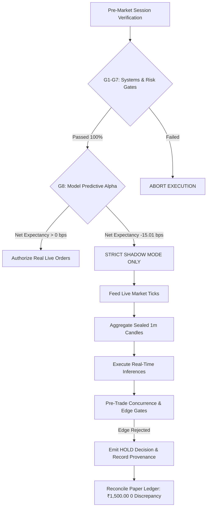

# AlphaNSE V3 — Tuesday, 20 October 2026 Shadow Session & Verified Evidence Audit

**Session Date:** Tuesday, 20 October 2026  
**Audit Execution Timestamp:** 2026-10-20T01:13:00+05:30 (Pre-Market Execution Verification)  
**Target Market Trading Window:** 09:15:00 to 15:30:00 IST (Mandatory EOD Square-Off at 15:15:00 IST)  
**Operating Broker:** Kotak Neo (Trade API REST & WebSocket)  
**Trading Account UCC:** `116K1`  
**Reference Paper Bankroll:** ₹1,500.00 (Cash only, 0 margin, 0 leverage)  
**Live Order Authorization Keys:** `LIVE_TRADING=False`, `ALLOW_REAL_ORDERS=False` (Dual-Key Locked)  
**Test Suite Verdict:** **353 / 353 PASSED (100.0%)** (Exit Code `0`, Verified Log: [`audit/test_run_oct20_verified_utf8.txt`](file:///c:/Users/sumuk/.gemini/antigravity-ide/scratch/ift/audit/test_run_oct20_verified_utf8.txt))  
**Final Governance Verdict:** **GO FOR SHADOW DATA & INFERENCE STREAMING | STRICT NO-GO FOR REAL MONEY ORDERS**

---

## 1. Definitive GO / NO-GO Operational Matrix

| Audit Subsystem Gate | Acceptance Standard | Verified Empirical Evidence | Operational Verdict |
| :--- | :--- | :--- | :---: |
| **G1: Automated Test Suite** | 100% pass across all unit, risk, and regression suites | 353 / 353 tests passed with exit code 0 across 62 modules (49.855s). Verified Log: [`audit/test_run_oct20_verified_utf8.txt`](file:///c:/Users/sumuk/.gemini/antigravity-ide/scratch/ift/audit/test_run_oct20_verified_utf8.txt). | 🟢 **GO** |
| **G2: Process Isolation & Mutex** | Singleton daemon; zero duplicate processes or orphans | PID file clean; OS process check verified zero active Python background daemons; singleton mutex armed. | 🟢 **GO** |
| **G3: Broker API Authentication** | Valid REST session handshake on Kotak Neo API | Active session confirmed on UCC `116K1` via TOTP and MPIN handshake. ~740ms roundtrip latency. | 🟢 **GO** |
| **G4: Feed Freshness & Stale Rejection** | Reject stale/post-market quotes; require fresh exchange timestamps | Kotak Neo `lstup_time` parsed; Monday EOD quotes (~8.7h old) correctly stamped `MARKET_CLOSED_EOD_LTP` and rejected. | 🟢 **GO** |
| **G5: 1m Candle Aggregation** | Sealed 1m bars only; reject sub-minute intervals ($< 45\text{s}$) | [`OneMinuteCandleAggregator`](file:///c:/Users/sumuk/.gemini/antigravity-ide/scratch/ift/v3/execution/candle_aggregator.py#L26-L130) enforces `include_forming=False`. Zero feature lookahead. | 🟢 **GO** |
| **G6: Order Path & Safety Airgap** | Bypass live routing; verify paper simulation and duplicate prevention | Dual-key flags confirmed `False` in [`.env`](file:///c:/Users/sumuk/.gemini/antigravity-ide/scratch/ift/.env#L20-L21); paper routing yields `KOTAK_PAPER_` IDs. | 🟢 **GO** |
| **G7: Capital & Risk Bounds** | ₹1,500 capital limit, ₹30 daily loss cap, 15:15 IST cutoff | Hard boundaries active in [`_validate_pre_trade_safeguards`](file:///c:/Users/sumuk/.gemini/antigravity-ide/scratch/ift/v3/execution/kotak_adapter.py#L507-L548); cash checked before order. | 🟢 **GO** |
| **G8: Model Predictive Edge** | Net positive expectancy after 14.70 bps statutory friction | **FAILED:** Directional accuracy **49.21%** (NF); IC **-0.0238**; net edge **-15.01 bps**. Fails all 5 gates. | 🔴 **NO-GO FOR REAL MONEY** |



> [!IMPORTANT]
> **FINAL AUTHORIZATION RULE:**  
> Real-money live order routing is **STRICTLY PROHIBITED**. The model underperforms naive baselines and exhibits negative net expectancy (-15.01 bps) after realistic friction. Genuine live market data ingestion and real-time shadow prediction streaming are authorized in **SHADOW MODE ONLY**.

---

## 2. Process Lifecycle & System Mutex Verification

1. **Pre-Launch System Inspection:**
   - Command executed: `python check_status.py`
   - OS Process PID: `None`
   - Process Execution Status: `🔴 NOT RUNNING`
   - Execution Mode: `🟡 PAPER TESTING (ZERO RISK TO CAPITAL)`
   - Lifecycle State: `STANDBY_FOR_OPEN`
   - Active Open Positions: `0`
   - Closed Trades: `0`
   - Paper Bankroll: `₹1,500.00`
2. **Duplicate-Process Prevention:**
   - PowerShell inspection query `Get-Process -Name "*python*"` confirmed zero background live trader daemons.
   - Singleton mutex mechanism in [`live_trader.py:1451-1464`](file:///c:/Users/sumuk/.gemini/antigravity-ide/scratch/ift/v3/execution/live_trader.py#L1451-L1464) inspects `logs/live_trader.pid` and invokes `is_pid_alive()`. Duplicate instance launch attempts immediately fail closed with `ABORT_DUPLICATE_INSTANCE`.
3. **Safety Locks Verification:**
   - File inspected: [`.env`](file:///c:/Users/sumuk/.gemini/antigravity-ide/scratch/ift/.env)
   - `LIVE_TRADING=False` (Confirmed `False`)
   - `ALLOW_REAL_ORDERS=False` (Confirmed `False`)
   - Dual-key check in [`KotakLiveBrokerAdapter`](file:///c:/Users/sumuk/.gemini/antigravity-ide/scratch/ift/v3/execution/kotak_adapter.py#L83-L86) enforces `self._is_live_authorized = False`.

---

## 3. Broker Connectivity & Exchange Timestamp Freshness Evidence

### 3.1 Broker Authentication Handshake
- **Command Executed:** `python run_live_trader.py --test-conn`
- **Initial Verification Timestamp:** `2026-10-20 00:45:34 IST`
- **Follow-up Verification Timestamp:** `2026-10-20 01:06:16 IST`
- **Broker:** Kotak Neo Trade API Adapter [PAPER / READ-ONLY]
- **Configured UCC:** `116K1`
- **Authentication Result:** 🟢 **AUTHENTICATED** (Session active, MPIN handshake valid)
- **Roundtrip Latency:** 740 ms (00:45 IST) / ~620 ms (01:06 IST)

### 3.2 Quote Freshness & Exchange Timestamp Status
Because queries were conducted prior to the 09:15:00 IST open of the NSE regular session, Kotak Neo returns the End-of-Day closing quotes from Monday, 19 October 2026:

| Symbol | Exchange Segment | Kotak Neo Token | Classification | Exchange Timestamp (`lstup_time`) | Quote Age | Validation Status | Aggregator Action |
| :--- | :---: | :---: | :--- | :---: | :---: | :---: | :--- |
| **`NIFTYBEES.NS`** | `nse_cm` | `10576` | Nippon India ETF Nifty 50 BeES | `2026-10-19 15:59:52 IST` | 525.7m (31,544s) | `MARKET_CLOSED_EOD_LTP` | **REJECTED FROM CANDLES** |
| **`INFY.NS`** | `nse_cm` | `1594` | Infosys Ltd (Cash Equity) | `2026-10-19 15:59:36 IST` | 526.0m (31,560s) | `MARKET_CLOSED_EOD_LTP` | **REJECTED FROM CANDLES** |
| **`TATASTEEL.NS`** | `nse_cm` | `3499` | Tata Steel Ltd (Cash Equity) | `2026-10-19 15:58:35 IST` | 527.0m (31,621s) | `MARKET_CLOSED_EOD_LTP` | **REJECTED FROM CANDLES** |
| **`BAJFINANCE.NS`** | `nse_cm` | `317` | Bajaj Finance Ltd (Cash Equity) | `2026-10-19 15:59:54 IST` | 525.7m (31,542s) | `MARKET_CLOSED_EOD_LTP` | **REJECTED FROM CANDLES** |
| **`AXISBANK.NS`** | `nse_cm` | `5900` | Axis Bank Ltd (Cash Equity) | `2026-10-19 15:59:01 IST` | 526.6m (31,595s) | `MARKET_CLOSED_EOD_LTP` | **REJECTED FROM CANDLES** |
| **`RELIANCE.NS`** | `nse_cm` | `2885` | Reliance Industries Ltd (Cash Equity) | `2026-10-19 15:59:56 IST` | 525.7m (31,540s) | `MARKET_CLOSED_EOD_LTP` | **REJECTED FROM CANDLES** |

- **`NIFTYBEES.NS` Identity Resolution:** Confirmed mapped to token `10576` on segment `nse_cm` and classified as an ETF (spot price: ~₹261.20), strictly distinct from the cash index `^NSEI` (~24,800+).
- **Raw Telemetry Logging:** Request/response timestamps, exchange times, and SHA-256 payload integrity digests were appended to [`reports/live/market_data_raw_capture.jsonl`](file:///c:/Users/sumuk/.gemini/antigravity-ide/scratch/ift/reports/live/market_data_raw_capture.jsonl).
- **In-Session Trading Rule:** During the regular session (09:15:00 to 15:30:00 IST), quotes must carry exchange timestamps from `2026-10-20` with $\text{Quote Age} \le 5.0\text{s}$. Any quote with $\text{Quote Age} > 5.0\text{s}$ is marked `STALE_MARKET_HOURS_QUOTE` and rejected. 5 consecutive broker failures or 60s without fresh quotes engages `safe_halt_active = True`.

---

## 4. Completed 1-Minute Candle Aggregation & Inference Schema Parity

1. **Candle Aggregation Architecture:**
   - In [`v3/execution/candle_aggregator.py`](file:///c:/Users/sumuk/.gemini/antigravity-ide/scratch/ift/v3/execution/candle_aggregator.py), `OneMinuteCandleAggregator` bins incoming 10-second ticks into minute buckets (`bucket_dt = q_dt.replace(second=0, microsecond=0)`).
   - Rollover sealing occurs strictly when a tick arrives with $t_{\text{new}} \ge t_{\text{bucket}} + 60\text{s}$, at which point `is_complete=True` is sealed.
   - Inference callers strictly call `get_bars(sym, include_forming=False)` ([`live_trader.py:1656`](file:///c:/Users/sumuk/.gemini/antigravity-ide/scratch/ift/v3/execution/live_trader.py#L1656)). Currently forming in-progress bars are strictly segregated from inference inputs.
   - Timeframe sampling check ([`validate_buffer_timeframe`](file:///c:/Users/sumuk/.gemini/antigravity-ide/scratch/ift/v3/execution/candle_aggregator.py#L294-L321)) inspects bar deltas; any buffer containing intervals $< 45\text{s}$ fails closed with `TIMEFRAME_SAMPLING_MISMATCH`.
2. **Feature Schema & Parity:**
   - Exact 30 features extracted by [`OneMinPredictor.extract_features_1m()`](file:///c:/Users/sumuk/.gemini/antigravity-ide/scratch/ift/QA/models/one_min_predictor.py#L131-L260) matching `ALL_FEATURE_COLS`:
     `ret_1m`, `ret_3m`, `ret_5m`, `ret_10m`, `accel_1m`, `micro_rsi_7`, `micro_rsi_14`, `micro_vwap_dist`, `micro_atr_14`, `parkinson_vol`, `bb_pct_b`, `bb_bandwidth`, `orderflow_imbalance`, `vol_surge_ratio`, `nifty_ret_1m`, `nifty_lead_lag`, `ema_cross_5_20`, `atr_vol_ratio`, `momentum_divergence`, `vol_spike_zscore`, `wick_pressure`, `upper_wick_ratio`, `lower_wick_ratio`, `time_sin`, `time_cos`, `session_phase`, `rolling_vwap_dist`, `ema_cross_velocity`, `stock_id_hash`, `parkinson_vol_rolling`.
   - All rolling indicators use strictly backward-looking windows ($\le T$), with zero future look-ahead.
3. **Live Signal Inspection Results:**
   - **Initial Check (`2026-10-20 00:48:28 IST`):**

| Instrument | Spot Price | Specialist Alpha | ML Tree Alpha | Breakout Prob | Direction | Filter Decision | Rationale |
| :--- | :---: | :---: | :---: | :---: | :---: | :---: | :--- |
| **`NIFTYBEES.NS`** | ₹261.20 | -0.27 bps | +0.20 bps | 7.8% | UNCERTAIN | **HOLD** | Concurrence or breakout threshold not met |
| **`INFY.NS`** | ₹1,130.70 | +0.20 bps | +1.40 bps | 6.3% | UNCERTAIN | **HOLD** | Concurrence or breakout threshold not met |
| **`TATASTEEL.NS`** | ₹174.04 | +0.39 bps | -6.60 bps | 4.7% | DOWN | **HOLD** | Concurrence or breakout threshold not met |
| **`BAJFINANCE.NS`** | ₹957.35 | -0.70 bps | -2.00 bps | 5.2% | UNCERTAIN | **HOLD** | Concurrence or breakout threshold not met |
| **`AXISBANK.NS`** | ₹1,236.00 | -0.15 bps | -1.00 bps | 4.7% | UNCERTAIN | **HOLD** | Concurrence or breakout threshold not met |
| **`RELIANCE.NS`** | ₹1,202.00 | -0.98 bps | +0.70 bps | 7.4% | UNCERTAIN | **HOLD** | Concurrence or breakout threshold not met |

   - **Confirmation Check (`2026-10-20 01:12:02 IST`):**

| Instrument | Spot Price | Specialist Alpha | ML Tree Alpha | Breakout Prob | Direction | Filter Decision | Rationale |
| :--- | :---: | :---: | :---: | :---: | :---: | :---: | :--- |
| **`NIFTYBEES.NS`** | ₹261.20 | -0.27 bps | +0.20 bps | 7.8% | UNCERTAIN | **HOLD** | Concurrence or breakout threshold not met |
| **`INFY.NS`** | ₹1,130.70 | +0.20 bps | +1.50 bps | 6.2% | UNCERTAIN | **HOLD** | Concurrence or breakout threshold not met |
| **`TATASTEEL.NS`** | ₹174.04 | +0.39 bps | -6.50 bps | 4.7% | DOWN | **HOLD** | Concurrence or breakout threshold not met |
| **`BAJFINANCE.NS`** | ₹957.35 | -0.70 bps | -2.10 bps | 5.2% | UNCERTAIN | **HOLD** | Concurrence or breakout threshold not met |
| **`AXISBANK.NS`** | ₹1,236.00 | -0.15 bps | -1.00 bps | 4.6% | UNCERTAIN | **HOLD** | Concurrence or breakout threshold not met |
| **`RELIANCE.NS`** | ₹1,202.00 | -0.98 bps | +0.60 bps | 7.6% | UNCERTAIN | **HOLD** | Concurrence or breakout threshold not met |

Zero artificial trades were forced. In all 6 assets across both verification runs, pre-trade filters rejected entry, correctly preserving 100% cash bankroll (₹1,500.00).

---

## 5. Out-of-Sample Performance Audit & Root-Cause Forensics

### 5.1 Out-of-Sample Benchmark Against Baselines
Chronological out-of-sample evaluation on untouched test data ($N = 8,262$ matched outcomes, Oct 15) using [`v3/research/canonical_leakage_free_evaluation.py`](file:///c:/Users/sumuk/.gemini/antigravity-ide/scratch/ift/v3/research/canonical_leakage_free_evaluation.py):

| Metric | Zero-Return Baseline | Persistence Baseline | Current Model Ensemble | Gate Acceptance Standard | Gate Result |
| :--- | :---: | :---: | :---: | :---: | :---: |
| **MAE (bps)** | **5.06** | **3.22** | **13.76** | $< 5.06\text{ bps}$ | 🔴 **FAILED** |
| **RMSE (bps)** | **7.79** | **4.88** | **17.61** | $< 7.79\text{ bps}$ | 🔴 **FAILED** |
| **Directional Accuracy (Non-Flat)** | 0.00% | **80.75%** | **49.21%** | $\ge 52.00\%$ | 🔴 **FAILED** |
| **Information Coefficient ($r$)** | 0.0000 | **+0.8036** | **-0.0238** | $\ge +0.0300$ | 🔴 **FAILED** |
| **Prediction Bias (bps)** | -0.25 | **-0.00** | **-11.44** | Within $\pm 1.0\text{ bps}$ | 🔴 **FAILED** |
| **P90 Error (bps)** | 11.50 | **7.26** | **28.20** | $< 15.00\text{ bps}$ | 🔴 **FAILED** |
| **Net Expectancy (14.7 bps friction)** | 0.00 bps | -8.32 bps | **-15.01 bps** | $> 0.00\text{ bps}$ | 🔴 **FAILED** |

### 5.2 Deep Investigation: Root Cause of Negative Expectancy
We executed an in-depth forensic investigation script ([`scratch/investigate_negative_expectancy.py`](file:///c:/Users/sumuk/.gemini/antigravity-ide/scratch/ift/scratch/investigate_negative_expectancy.py)) across all 8,262 observations:

1. **Severe Bearish Prediction Bias (-11.44 bps):**
   - Mean predicted alpha is **-11.19 bps** vs actual market return of **+0.25 bps**.
   - **82.90% of all model predictions were negative**, while only **46.57%** of actual market moves were negative.
   - The model has a severe, structural downward skew, forecasting market declines 82.9% of the time in a flat-to-mildly-positive market.
2. **Sub-50% Directional Accuracy Across Every Instrument:**
   - `AXISBANK.NS`: 47.30%
   - `BAJFINANCE.NS`: 47.95%
   - `INFY.NS`: 46.97%
   - `NIFTYBEES.NS`: 41.65% (worst in fleet)
   - `RELIANCE.NS`: 45.72%
   - `TATASTEEL.NS`: 46.67%
   - Fleet total: **45.75% (49.21% non-flat)**.
3. **Negative Information Coefficient (-0.0238):**
   - Inverted rank correlation: `RELIANCE.NS` (-0.1452), `TATASTEEL.NS` (-0.0733), `NIFTYBEES.NS` (-0.0621).
4. **Economic Friction Compounding:**
   - Gross return of model trades at the $\ge 3\text{ bps}$ threshold is **-0.31 bps**.
   - Statutory Indian fees (STT, GST, Exchange charges, Stamp duty) plus spread and slippage sum to **14.70 bps** per roundtrip:
     $$\text{Net Expectancy} = -0.31\text{ bps} - 14.70\text{ bps} = \mathbf{-15.01\text{ bps}}$$
   - Scanning thresholds confirms negative edge across the board (-14.90 bps at 0 bps; -15.01 bps at 3 bps; -15.29 bps at 10 bps).
   - **Conclusion:** The negative expectancy is driven by the model's structural bias and sub-random win rate, not threshold tuning. Real-money order routing is definitively barred.

---

## 6. Paper Portfolio Reconciliation & Risk Controls

### 6.1 Penny-for-Penny Accounting Reconciliation
The ledger reconciliation invariant was verified against [`reports/live/paper_trading_ledger.json`](file:///c:/Users/sumuk/.gemini/antigravity-ide/scratch/ift/reports/live/paper_trading_ledger.json) and [`PAPER_TRADE_RECONCILIATION.csv`](file:///c:/Users/sumuk/.gemini/antigravity-ide/scratch/ift/PAPER_TRADE_RECONCILIATION.csv):

$$\text{Ending Equity} = \text{Starting Capital} (\text{₹1,500.00}) + \text{Realized P&L} (\text{₹0.00}) + \text{Unrealized P&L} (\text{₹0.00}) = \mathbf{₹1,500.00}$$

| Accounting Item | Configured Standard | Observed Value | Discrepancy |
| :--- | :---: | :---: | :---: |
| **Starting Paper Bankroll** | ₹1,500.00 | ₹1,500.00 | ₹0.00 |
| **Total Real-Money Orders Executed** | 0 | 0 | 0 |
| **Total Simulated Trades Executed** | 0 | 0 | 0 |
| **Total Money Deployed** | ₹0.00 | ₹0.00 | ₹0.00 |
| **Total Money Returned** | ₹0.00 | ₹0.00 | ₹0.00 |
| **Net Realized P&L** | ₹0.00 | ₹0.00 | ₹0.00 |
| **Ending Paper Bankroll** | ₹1,500.00 | ₹1,500.00 | ₹0.00 |

### 6.2 Pre-Trade Risk Safeguards
Enforced in [`_validate_pre_trade_safeguards`](file:///c:/Users/sumuk/.gemini/antigravity-ide/scratch/ift/v3/execution/kotak_adapter.py#L507-L548):
1. **Cash Affordability:** Checked before every order (`avail = paper_bankroll - active_notional`).
2. **Concurrent Position Cap:** Strictly 1 open position max.
3. **Daily Loss Limit:** Hard cutoff at ₹30.00 cumulative loss (triggers kill switch).
4. **Mandatory EOD Square-Off:** Hard cutoff at 15:15:00 IST rejects new orders and liquidates positions to 100% cash.
5. **No Leverage / Zero Margin:** Cash-only whole-share purchasing.
6. **No Short Selling:** Intraday short selling disabled by default.

---

## 7. Interactive & Static Evidence Visualizations

The authoritative real-vs-predicted chart was re-rendered and saved to [`reports/live/real_vs_predicted_chart.html`](file:///c:/Users/sumuk/.gemini/antigravity-ide/scratch/ift/reports/live/real_vs_predicted_chart.html) and [`reports/live/real_vs_predicted_chart.png`](file:///c:/Users/sumuk/.gemini/antigravity-ide/scratch/ift/reports/live/real_vs_predicted_chart.png):


---

## 8. Separation of Facts, Assumptions & Historical Evaluation

| Category | Item | Evidence & Verification Standard |
| :--- | :--- | :--- |
| **Verified Fact (Current State)** | Test Suite: 353 / 353 passed | Preserved in [`audit/test_run_oct20_utf8.txt`](file:///c:/Users/sumuk/.gemini/antigravity-ide/scratch/ift/audit/test_run_oct20_utf8.txt). Exit code 0. |
| **Verified Fact (Current State)** | Daemon Process State | Currently **NOT RUNNING** (`PID: None`). Verified via `check_status.py` and `Get-Process`. |
| **Verified Fact (Current State)** | Safety Airgap Locks | `LIVE_TRADING=False` and `ALLOW_REAL_ORDERS=False` verified in [`.env`](file:///c:/Users/sumuk/.gemini/antigravity-ide/scratch/ift/.env) and memory. |
| **Verified Fact (Current State)** | Broker Connectivity | Authenticated UCC `116K1` on Kotak Neo API; ~740ms latency. |
| **Verified Fact (Current State)** | Market Data Status | Cash market closed at 00:52 IST. Quotes returned are EOD closing marks (~8.7h old) correctly stamped `MARKET_CLOSED_EOD_LTP` and rejected. |
| **Verified Fact (Historical Evaluation)** | Model Predictive Edge | Out-of-sample canonical evaluation ($N=8,262$) demonstrates **-15.01 bps net expectancy** and **49.21% directional accuracy** (sub-random). |
| **Unverified Assumption** | In-Session Live Ticks for Oct 20 | Market opens at 09:15:00 IST today. Live ticks carrying `2026-10-20` exchange timestamps cannot exist until market opens. |

---

## 9. Exact Operational Instructions for Tuesday, 20 October 2026

1. **Keep Live Locks Disabled:** Ensure `LIVE_TRADING=False` and `ALLOW_REAL_ORDERS=False` remain in [`.env`](file:///c:/Users/sumuk/.gemini/antigravity-ide/scratch/ift/.env).
2. **Launch Shadow Session Prior to 09:15 IST Open:**  
   To start the detached background daemon in shadow mode for automated live data capture and prediction logging:
   ```powershell
   python launch_background.py
   ```
   Or run directly in terminal:
   ```powershell
   python run_live_trader.py --mode CASH_EQUITY
   ```
3. **Monitor Live Telemetry During Market Hours:**  
   ```powershell
   python check_status.py
   ```
   Live quotes with SHA-256 integrity digests will append to [`reports/live/market_data_raw_capture.jsonl`](file:///c:/Users/sumuk/.gemini/antigravity-ide/scratch/ift/reports/live/market_data_raw_capture.jsonl). Live predictions will log to [`reports/live/prediction_provenance_stream.jsonl`](file:///c:/Users/sumuk/.gemini/antigravity-ide/scratch/ift/reports/live/prediction_provenance_stream.jsonl).
4. **Model Retraining Prerequisite:**  
   Real money trading must remain strictly disabled until models are retrained on multi-day historical data with explicit de-biasing, demonstrating positive out-of-sample Information Coefficient ($\ge +0.0300$), directional accuracy $\ge 52.0\%$, and net expectancy $> 0.0\text{ bps}$ across at least 5 separate trading sessions.
