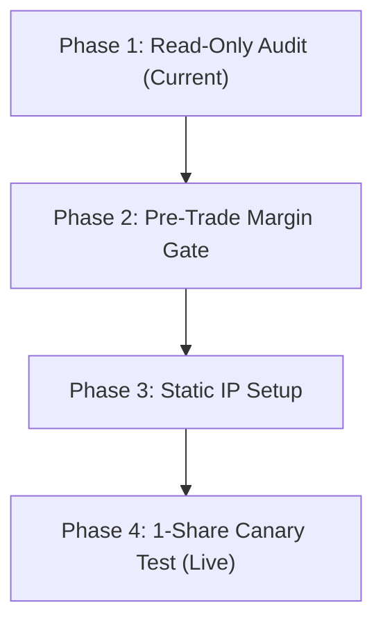

# AlphaNSE ➔ DhanHQ Integration Guide & Roadmap

This document outlines the phased engineering process for connecting AlphaNSE's quantitative models to the **DhanHQ API (v2.1.0+)**.

---

## 1. System Architecture

```
┌────────────────────────────────────────────────────────┐
│                      AlphaNSE                          │
│   (V2_15M, HYPO001, SMC_4CONF_920 Statistical Signals) │
└──────────────────────────┬─────────────────────────────┘
                           │ Proposed Trade
                           ▼
┌────────────────────────────────────────────────────────┐
│         Dhan Pre-Trade Cost & Margin Gate              │
│       (Calls dhan.margin_calculator(...) via API)      │
│  - Calculates exact exchange margin needed             │
│  - Calculates brokerage (₹20) + STT + GST + stamp duty │
│  - Verifies: (Expected Gross Profit - Charges) > ₹0.80 │
└──────────────────────────┬─────────────────────────────┘
                           │ If Net Edge is POSITIVE
                           ▼
┌────────────────────────────────────────────────────────┐
│             Pre-Trade Risk Engine (Local)              │
│  - Check: Is LIVE_TRADING == True?                     │
│  - Check: Daily loss < MAX_DAILY_LOSS (₹30 - ₹50)?     │
│  - Check: Capital deployed < MAX_CAPITAL (₹1,500)?     │
│  - Check: Concurrent positions == 0?                   │
└──────────────────────────┬─────────────────────────────┘
                           │ If ALL Risk Checks PASS
                           ▼
┌────────────────────────────────────────────────────────┐
│                  DhanAdapter (Python)                  │
│            (Uses DhanHQ v2.1.0 DhanContext)            │
└──────────────────────────┬─────────────────────────────┘
                           │ Static-IP Whitelisted TLS
                           ▼
┌────────────────────────────────────────────────────────┐
│                      DhanHQ API                        │
│                   (Exchange Gateway)                   │
└──────────────────────────┬─────────────────────────────┘
                           │
                           ▼
               National Stock Exchange (NSE)
```

---

## 2. Key Microstructure Realities (DhanHQ v2 Specifics)

### A. 24-Hour Access Token Validity
* **Rule:** Personal Access Tokens generated from the Dhan Web console have a **24-hour expiration**.
* **Impact:** AlphaNSE must not assume a permanent token. Before each market session (e.g. at 09:00 AM pre-market check), verify the token with `dhan.get_fund_limits()`. If expired, generate a fresh token on the Dhan console and update `.env`.

### B. Static IP Whitelisting for Order APIs
* **Rule:** DhanHQ v2 separates Read APIs (Funds, Holdings, Positions) from Order APIs (Place, Modify, Cancel).
* **Security Requirement:** To use Order APIs, Dhan requires whitelisting your machine's **Static Public IP address** in the Dhan developer portal.
* **Impact:** Read-only testing (Phase 1) works from any network. Live order placement (Phase 4) requires registering your ISP's public IP in your Dhan portal.

### C. Pre-Trade Cost & Margin Gate (`margin_calculator`)
* **Rule:** AlphaNSE trades short-horizon momentum. A gross gain of +0.50% can easily become a net loss after broker fees.
* **Solution:** Before any order is authorized, AlphaNSE queries:
  ```python
  dhan.margin_calculator(
      security_id="1594",
      exchange_segment=dhan.NSE,
      transaction_type=dhan.BUY,
      quantity=1,
      product_type=dhan.INTRA,
      price=1850.0
  )
  ```
  If `expected_gross_profit - total_statutory_charges < MIN_NET_EDGE`, the order is automatically discarded.

---

## 3. Four-Phase Rollout Plan



| Phase | Description | Order Placement Allowed? | Real Capital at Risk |
| :--- | :--- | :---: | :---: |
| **Phase 1** | Run [`dhan_readonly_test.py`](file:///c:/Users/sumuk/.gemini/antigravity-ide/scratch/ift/v3/execution/dhan_readonly_test.py) to audit funds, positions, and order book | ❌ NO | **₹0.00** |
| **Phase 2** | Integrate `margin_calculator` into AlphaNSE's cost engine | ❌ NO | **₹0.00** |
| **Phase 3** | Verify and whitelist static IP in Dhan developer portal | ❌ NO | **₹0.00** |
| **Phase 4** | 1-share live canary test on high-liquidity stock with ₹30 hard daily stop-loss | 🟢 YES (1 share) | Max ₹30.00 |

---

## 4. How to Run Phase 1 (Read-Only Test)

1. **Copy Configuration Template:**
   ```powershell
   copy .env.example .env
   ```
2. **Add Credentials in `.env`:**
   ```ini
   DHAN_CLIENT_ID=1000000000
   DHAN_ACCESS_TOKEN=your_24hr_token_here
   LIVE_TRADING=False
   ```
3. **Execute Read-Only Script:**
   ```powershell
   uv run python v3/execution/dhan_readonly_test.py
   ```
4. **Expected Output:**
   - Available funds and margin limits.
   - Current open positions.
   - Demat holdings.
   - Today's order book.
   - Sample margin calculation for 1 share of INFY.
